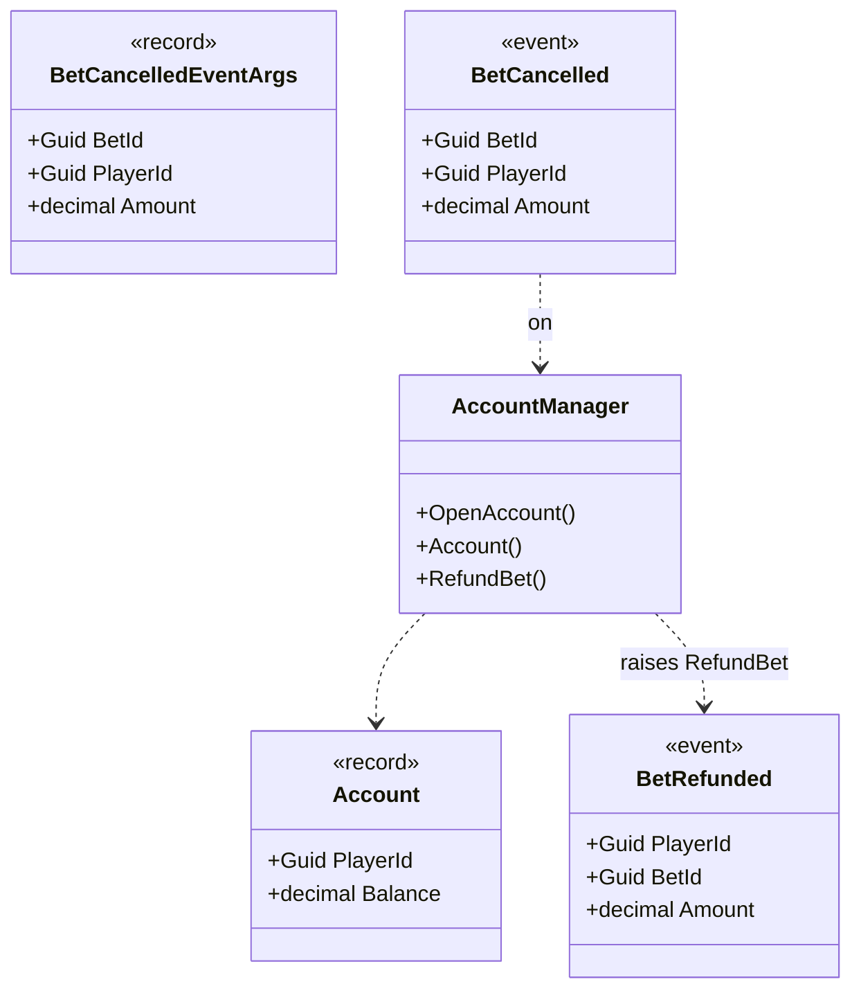

# Account

Holds players' funds and returns cancelled bet amounts.

[Business API](index.md) · [Reference](account.reference.md)

## Operations

- [OpenAccount](account.reference.md#type-game-core-accountmanager-openaccountasync) — Opens an account with the player's initial funds.

- [Account](account.reference.md#type-game-core-accountmanager-accountasync) — Shows the player's available funds.

- [RefundBet](account.reference.md#type-game-core-accountmanager-refundbetasync) — Returns the bet amount to the player after cancellation.

## Events

- [BetRefunded](account.reference.md#type-game-core-betrefunded) — A cancelled bet amount was returned to the player.

## Connections

- [RefundBet](account.reference.md#type-game-core-gameaccountconnections-refundbetasync) — Return the bet amount to the player's account after cancellation.

## Models

- [BetRefunded](account.reference.md#type-game-core-betrefunded) — A cancelled bet amount was returned to the player.

- [Account](account.reference.md#type-game-model-account) — The funds available to a player.

## Diagram

