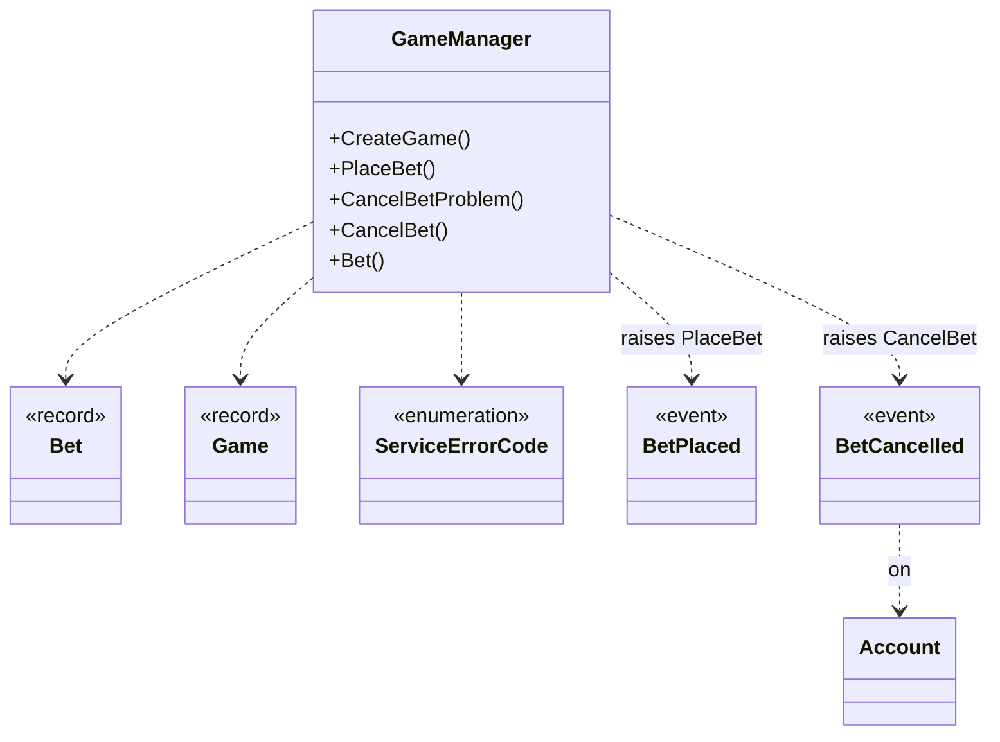

# Game

Lets players place bets and cancel them until their game starts.

[Business API](index.md) · [Reference](game.reference.md)

## Operations

- [CreateGame](game.reference.md#type-game-core-gamemanager-creategameasync) — Sets when the game starts and bets can no longer be cancelled.

- [PlaceBet](game.reference.md#type-game-core-gamemanager-placebetasync) — Places a player's bet on an existing game.

- [CancelBetProblem](game.reference.md#type-game-core-gamemanager-cancelbetproblemasync) — Explains why the player cannot cancel the bet.

- [CancelBet](game.reference.md#type-game-core-gamemanager-cancelbetasync) — Lets the player cancel an open bet before the game starts.

- [Bet](game.reference.md#type-game-core-gamemanager-betasync) — Lets the player see the bet's current state.

## Events

- [BetPlaced](game.reference.md#type-game-core-gameeventpublisher-betplaced) — The player's bet has been placed.

- [BetCancelled](game.reference.md#type-game-core-gameeventpublisher-betcancelled) — The player's bet has been cancelled.

## Connections

- [RefundBet](account.reference.md#type-game-core-gameaccountconnections-refundbetasync) — Return the bet amount to the player's account after cancellation.

## Models

- [Bet](game.reference.md#type-game-model-bet) — A player's bet on a game, including its current cancellation state.

- [BetCancelledEventArgs](game.reference.md#type-game-model-betcancelledeventargs) — Identifies the bet whose cancellation has been recorded.

- [BetPlacedEventArgs](game.reference.md#type-game-model-betplacedeventargs) — The recorded bet announced to listeners.

- [BetState](game.reference.md#type-game-model-betstate) — The lifecycle of a player's bet.

- [Game](game.reference.md#type-game-model-game) — A scheduled game that players can bet on.

- [ServiceErrorCode](game.reference.md#type-game-model-serviceerrorcode) — Reasons a requested game operation cannot proceed.

## Diagram

